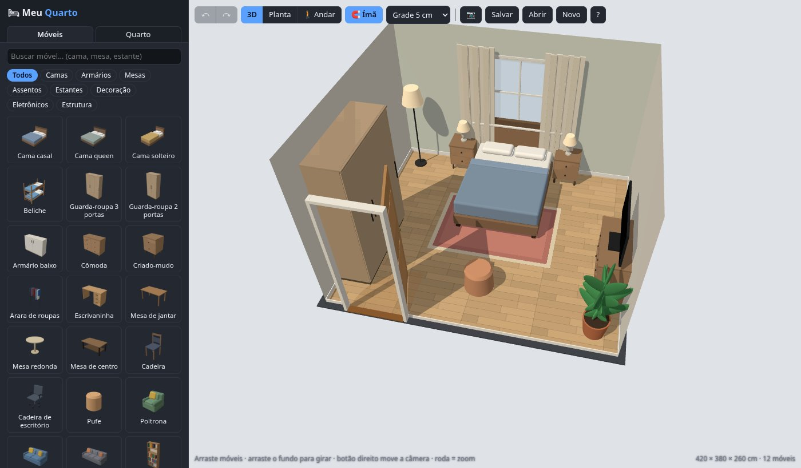
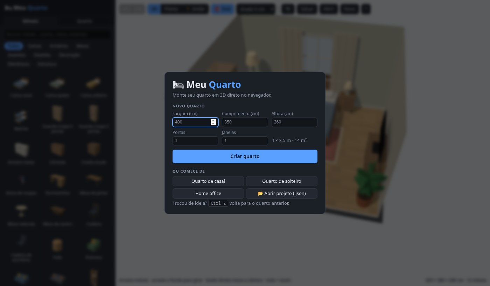
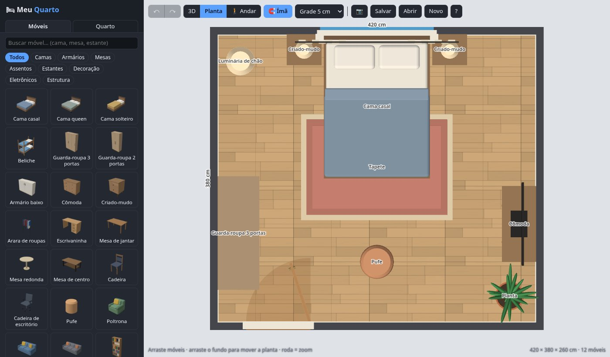
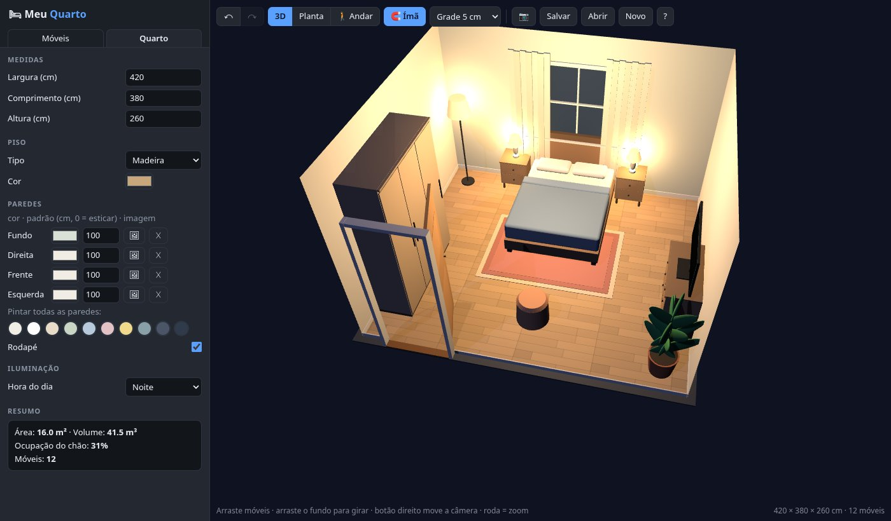

# 🛏 Meu Quarto

Monte o seu quarto em 3D direto no navegador: medidas, portas, janelas, móveis, pôsteres e papel de parede com as suas próprias imagens. Roda no Windows, no Linux e no Mac, sem instalar nada.



## Como usar

- **Baixar (funciona sem internet):** baixe o [`MeuQuarto.html`](https://github.com/cutarev/quarto/releases/latest/download/MeuQuarto.html) da página de [Releases](https://github.com/cutarev/quarto/releases) e dê dois cliques. Ele abre no navegador (Chrome, Edge ou Firefox).
- **Usar online:** [cutarev.github.io/quarto](https://cutarev.github.io/quarto/quarto.html)

Na tela de entrada você digita a largura, o comprimento e a altura do quarto (em cm) e quantas portas e janelas ele tem. Também dá para começar de um exemplo pronto.

| Tela de entrada | Planta com cotas | À noite |
|---|---|---|
|  |  |  |

## O que tem

- **35 móveis com modelo 3D**: camas (casal, queen, solteiro, beliche), guarda-roupas, armário, cômoda, criado-mudo, arara, escrivaninha, mesas, cadeiras, cadeira de escritório, pufe, poltrona, sofás, estantes com livros, nichos, prateleira de parede, rack, tapetes, plantas, luminárias, espelho, TV, computador, notebook…
- **Estrutura**: portas (abrem de verdade, com dobradiça e lado configuráveis), janelas (divisões, peitoril, cortina) e pôsteres com moldura. Portas e janelas furam a parede.
- **Vistas**: 3D, planta 2D (com grade, cotas de distância até as paredes e nomes) e 🚶 andar dentro do quarto (WASD + mouse).
- **Ímã**: encaixa em paredes e outros móveis e vira o móvel de costas para a parede (`Shift` ao arrastar ignora o ímã). Itens pequenos pousam em cima de mesas e cômodas. Móveis batendo uns nos outros ou bloqueando a porta ficam com o chão vermelho.
- Pisos com textura (madeira, porcelanato, cimento, carpete), paredes com cor ou papel de parede, rodapé, hora do dia (dia, entardecer e noite, com luminárias acesas) e sombras.
- Desfazer/refazer, foto do quarto em PNG e atalhos de teclado (tecla `?` mostra todos).

**Seus projetos:** o quarto fica salvo sozinho no navegador. **Salvar** gera um `.json` com tudo, inclusive as imagens, para guardar ou mandar para alguém; **Abrir** carrega de volta.

## Desenvolvimento

Tudo fica em `quarto.html` (HTML + JavaScript, [three.js](https://threejs.org) 0.160 via CDN). É só abrir no navegador.

`python3 build.py` gera `dist/MeuQuarto.html`, que é o mesmo arquivo com o three.js embutido para funcionar offline. É ele que vai nos releases:

```sh
python3 build.py && gh release create v1.1 dist/MeuQuarto.html
```

### Como o código funciona

- `state` (`room`, `walls[4]`, `objs[]` com `kind` = `item|door|window|poster`) é a única fonte da verdade; `sync()` atualiza a cena de forma incremental (cada objeto só é reconstruído quando muda a geometria; arrastar só move).
- Modelos: `def(tipo, meta, build)` recebe um `kit` (`b` caixa, `rb` caixa arredondada, `cy` cilindro, `el` elipsoide); tudo com o mesmo material é fundido em um mesh só. O catálogo (`CATALOG`) liga nome/tamanho/cor padrão a um tipo de modelo; as miniaturas são renderizadas dos próprios modelos.
- Móveis: a frente aponta para +z local; `rot` = 0/90/180/270 vira para Fundo→Frente / Esquerda→ / … (`FACE_ROT` dá a rotação de costas pra cada parede).
- Paredes: 0=Fundo (z=0), 1=Direita (x=W), 2=Frente (z=D), 3=Esquerda (x=0). Objetos de parede usam `wall` + `pos` (centro ao longo da parede). São planos de um lado só virados pra dentro, então a parede entre a câmera e o quarto some sozinha.
- Imagens ficam em `assets` (id → data URL), reduzidas a 2048 px ao importar; o projeto salvo carrega só as usadas. Arquivos antigos (v1) são migrados ao abrir.
- Tela de entrada (`#start`): cria o quarto com as medidas digitadas (portas na parede da Frente, janelas no Fundo) via `replaceState`, que mantém o histórico para o `Ctrl+Z` voltar.

## Licença

[MIT](LICENSE): pode usar, copiar, modificar e distribuir à vontade, desde que mantenha o aviso de copyright.
